# Azure 文本转语音 (Azure TTS Studio)

一个本地运行的 Web 应用,提供调用微软 Azure Cognitive Services 文本转语音 (Text-to-Speech) 的友好界面。后端使用 FastAPI，前端使用 React、TypeScript 和 Vite，密钥只存在本机,不会暴露给浏览器。

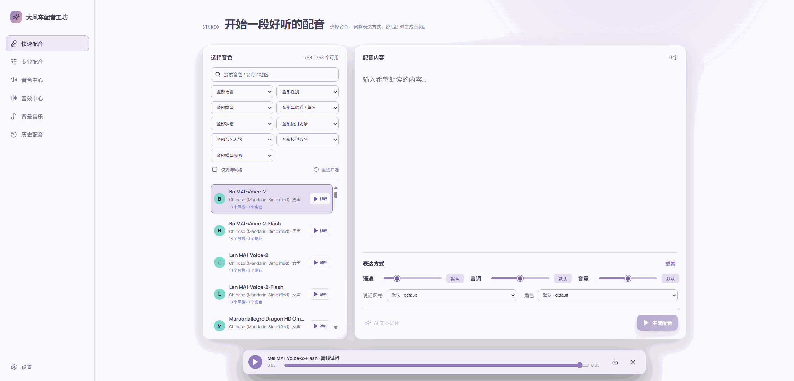

## 功能

- 设置菜单:配置端点 (Endpoint) / 区域 (Region) / 密钥 (Key),可一键**测试连接**,成功后自动拉取音色列表
- 音色库:支持按语言筛选、按名字搜索,显示性别标签
- 合成台:
  - 输入文本 (任意长度,超过 1800 字字符**自动分段合成后拼接**)
  - 调语速 / 音调 / 音量 (滑块,留空即用默认)
  - 选择说话风格 (mstts:express-as,自动按音色支持的 StyleList 动态填充)
  - 选择角色 (role,OLT / Young / Senior 等)
- 顶部模式菜单:
  - **快速配音**保留原有文本、参数和 AI 检测工作流
  - **专业配音**可编辑完整 Azure SSML，支持多音色、`break`、`prosody`、`mstts:express-as`、`say-as`、段落和句子等标签
  - 提供常用标签插入工具、XML/SSML 结构检查、字符/字节统计；完整 SSML 会原样提交 Azure，不做破坏结构的自动分段
- 音频播放条:页面底部胶囊式播放条,带频谱可视化动画,显示时长
- 下载音频 / 历史记录 (本机持久化,可单条删除)

## 目录结构

```
Azure_TTS/
├── backend/
│   ├── main.py             FastAPI 开发入口
│   ├── app/                后端应用包（路由、服务、配置）
│   │   ├── api.py          HTTP API 路由
│   │   ├── factory.py      应用装配
│   │   ├── core/           配置与基础设施
│   │   └── services/       Speech、SSML、历史业务服务
│   ├── tests/              不依赖 Azure 密钥的回归测试
│   └── requirements.txt
├── frontend/               React + TypeScript + Vite 前端
│   ├── src/                页面、组件、状态与 API 客户端
│   └── public/             favicon 等直接复制的公共资源
├── docs/assets/readme/     README 使用的演示图片
├── config.json             保存的配置 (运行后自动生成,含 apiKey,请勿提交 git)
└── history/                历史音频 + 元数据 (.bin / .json)
```

## 安装与运行

```bash
cd frontend
npm ci
npm run build

cd ../backend
python -m venv .venv
# Windows: .venv\Scripts\activate   | macOS/Linux: source .venv/bin/activate
pip install -r requirements.txt
python main.py
```

也可以直接运行项目根目录的 `start.bat`（Windows）或 `start.sh`（macOS/Linux）；首次启动且缺少前端构建时，脚本会自动安装依赖并完成构建。

打开浏览器访问 <http://127.0.0.1:8000>。

## 开发检查

修改后端或前端模块后，可在项目根目录运行以下检查：

```bash
python -m unittest discover -s backend/tests -v
cd frontend
npm run check
npm run build
```

测试不会请求 Azure Speech，也不会使用或写入现有的音频历史；覆盖健康检查、配置脱敏、SSML 安全校验与音频格式映射。

## 配置 Azure Speech 资源

1. 在 [Azure Portal](https://portal.azure.com) 创建 **Azure AI Speech** 资源(AI Services kind,F0 免费层即可)
2. 进入资源 → "密钥和终结点" (Keys and Endpoint),复制
   - **Key 1**
   - **Endpoint**,形如 `https://<your-resource>.services.ai.azure.com/`
3. 在本应用右上角点击"设置",把端点和密钥填入,点击"测试连接"
   - 成功后会显示中文音色数量,音色库自动加载

REST 路径说明:本后端固定走经典 Azure AI Speech REST 形式:
- 列出音色:`GET {endpoint}/cognitiveservices/voices/list`
- 合成语音:`POST {endpoint}/cognitiveservices/v1`(body 为 SSML)
- 本地 SSML 校验:`POST /api/ssml/validate`，JSON body 为 `{ "ssml": "<speak ...>...</speak>" }`
- 专业 SSML 合成:`POST /api/speak-ssml`，JSON body 同上
- `endpoint` 直接用填入的请求地址(去尾部 `/`),可填自定义资源端点(如 `https://xxx.services.ai.azure.com/`)或区域专用 TTS 域名(如 `https://eastus.tts.speech.microsoft.com`);无需 region 字段。

## 音色速查

中文常用音色 (ShortName):
- 女声: `zh-CN-XiaoxiaoNeural` (晓晓,多风格)、`zh-CN-XiaoyiNeural` (晓伊)、`zh-CN-XiaohanNeural`
- 男声: `zh-CN-YunyangNeural` (云扬)、`zh-CN-YunjianNeural` (云健)、`zh-CN-YunxiNeural` (云希)

## AI 检测 (大模型) 配置

"设置"弹窗里多了一个 Tab:**大模型 AI 检测**。配置完后工坊合成区"合成"按钮左侧的"AI 检测"按钮会高亮可点;没配置时呈灰色禁用状态。点击会用大模型对文本框内容做错别字、标点、语义、中英文混合、TTS 朗读优化等多维检测,返回结构严格 JSON。前端会:

1. 用 LLM 返回的 `tts_text` 字段**替换**文本框内容(若为空则保留原文并 toast 提示)
2. 把 `summary` 字段展示在合成按钮区下方,带评分 + 问题数标签

支持的厂商(均走 OpenAI 兼容协议 `/v1/chat/completions` + Bearer key):

| 厂商 | 默认 base URL | 默认模型 |
|---|---|---|
| 智谱 GLM | `https://open.bigmodel.cn/api/paas/v4` | glm-4-flash |
| DeepSeek | `https://api.deepseek.com/v1` | deepseek-chat |
| Kimi (月之暗面) | `https://api.moonshot.cn/v1` | moonshot-v1-8k |
| 通义千问 | `https://dashscope.aliyuncs.com/compatible-mode/v1` | qwen-plus |
| MiniMax | `https://api.minimax.chat/v1` | abab6.5s-chat |
| 豆包 Doubao | `https://ark.cn-beijing.volces.com/api/v3` | doubao-1-5-pro-32k |
| 自定义 | 用户填 | 用户填 |

操作流程:
1. 选厂商 → 自动填默认请求地址和默认模型(可直接保存)
2. 填 API Key
3. 点"获取模型列表" → 后端调 `{base}/models` 拉所有可用模型
4. 在"默认模型"下拉里选一个(必选)
5. 点"测试连接"验证 + "保存 LLM 配置"

检测 prompt 固化在后端 `backend/prompt/text _detection.txt`,LLM 强制 `response_format: {"type":"json_object"}` 并对返回做容错 JSON 解析,即便个别厂商不支持 JSON mode 也能兜底。

## 设计取舍说明

- **配置存储在服务端** `config.json`,而非常浏览器 localStorage:密钥不出后端,换浏览器/设备无需重填;代价是要本机跑后端进程。
- **长文本分段**:Azure 单次合成约 5000 字符上限,本项目按 1800 字符分段,合成后**直接字节拼接**播放。简单 mp3 字节拼接在主流浏览器 `<audio>` 上可正常播放和解码;如需严格无缝合并,可改用 ffmpeg 拼接 (需额外依赖)。
- **SSML** 由后端构造,前端只发送语义字段 (rate/pitch/volume/style/role),避免前端手拼 XML 出错或注入。
- 输出格式默认 `audio-16khz-128kbitrate-mono-mp3`,在设置弹窗里可调整为 24kHz / 48kHz / WAV / OGG。

## 常见问题

- **音色测试连接只有556个**: 区域要选择: eastus，768个音色才是正常的。
- **测试连接显示 HTTP 401**:apiKey 不对,或在错误区域。
- **测试连接显示 HTTP 403**:可能用了免key 部署模式,或区域与资源不匹配。
- **音色列表为空**:Azure 部分订阅未开通 neural 音色,确认资源区域支持 Neural。
- **合成音频听不到**:浏览器对 mp3 简单拼接的解码通常 OK;若换格式后失败,建议保持默认 mp3 16kHz。

## Azure TTS配置的第一种方案，创建 Foundry 资源(付费)
在 Azure 门户中创建一个 Foundry 资源。官网地址：[https://portal.azure.com](https://portal.azure.com)

1. 填写创建 Foundry 资源，填写所需的基础信息
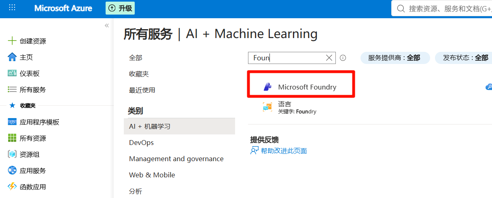
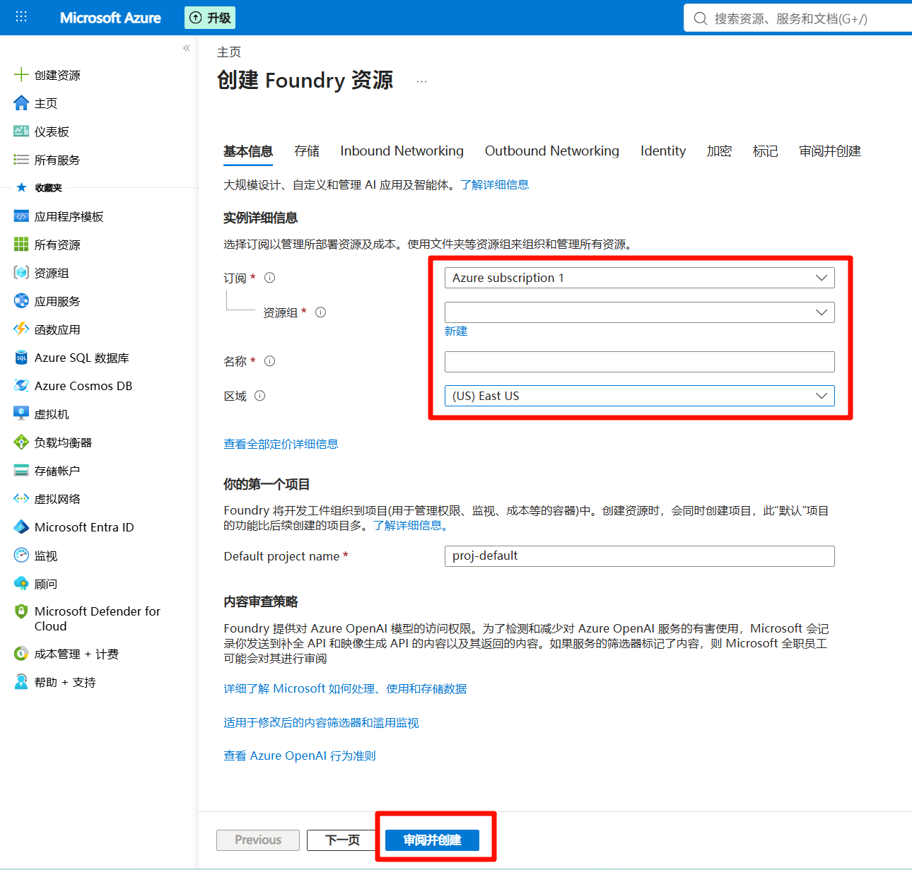

2. 探索模型，查看是否存在模型
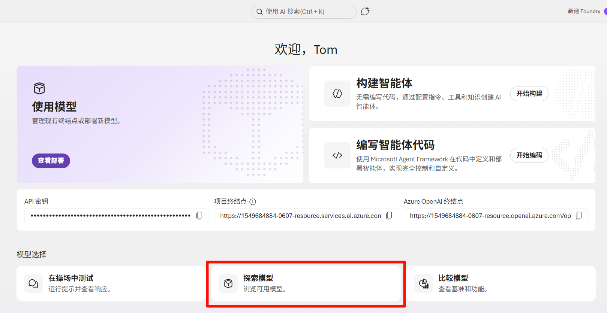
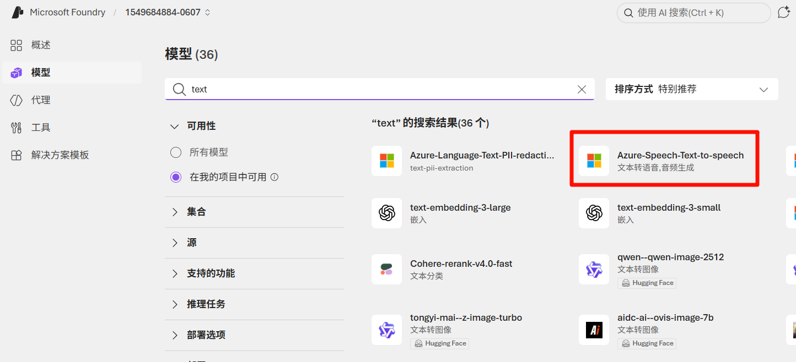

3. 查看请求地址和密钥
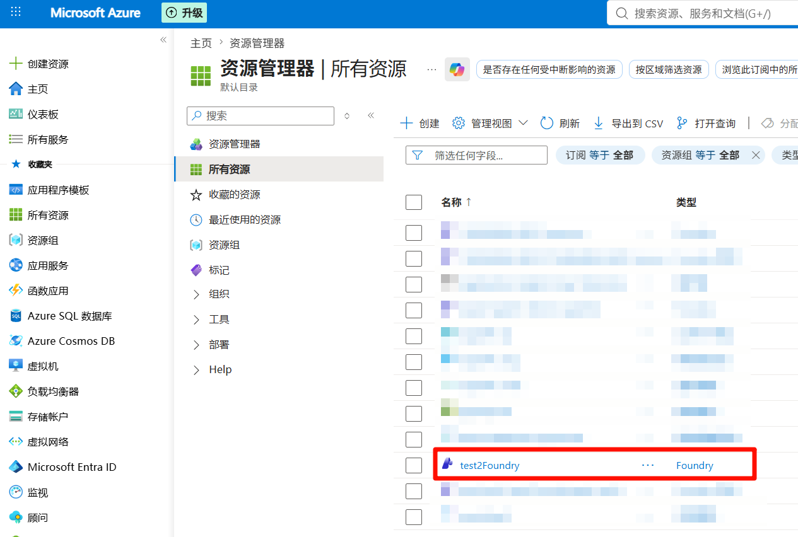
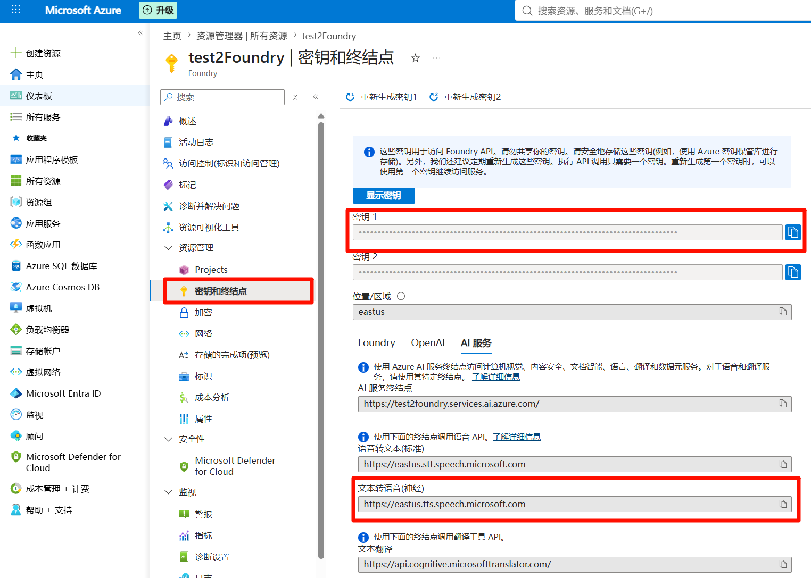

## Azure TTS配置的第二种方案，创建语言服务(免费，限50万字)
在 Azure 门户中创建一个语音服务资源。官网地址：[https://portal.azure.com](https://portal.azure.com)

1. 查询语音服务资源，然后创建语音服务资源
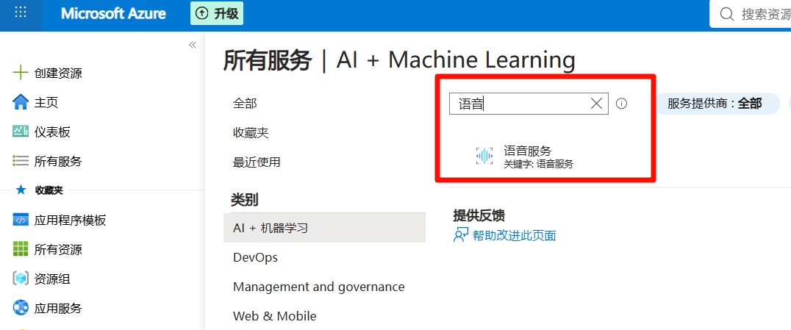
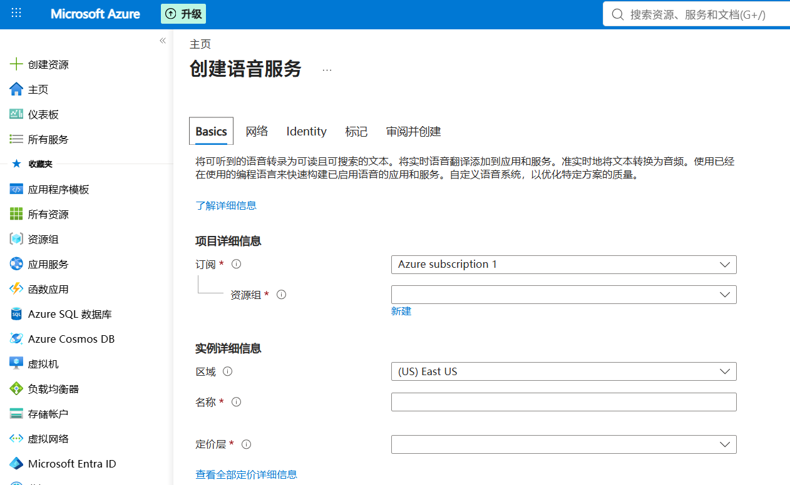

2. 查看创建的语音服务资源，然后获取请求地址和密钥
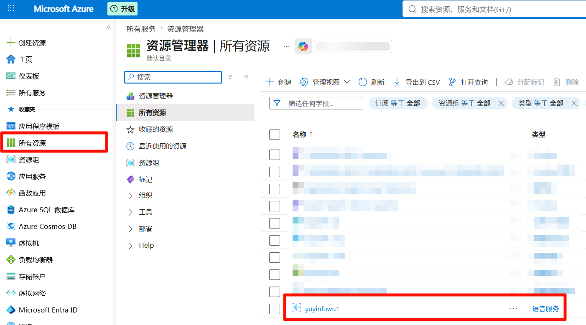
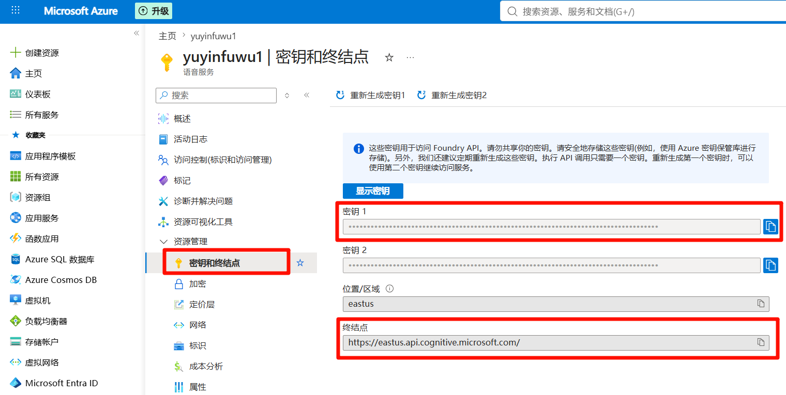
